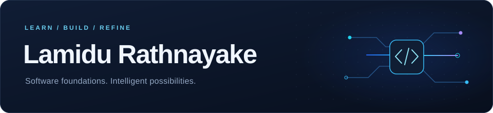
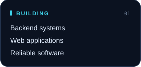
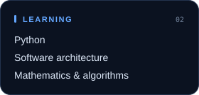
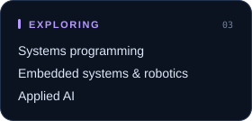
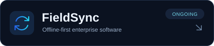
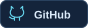

<picture>
  <source media="(max-width: 600px)" srcset="assets/hero-mobile.svg">
  
</picture>

<strong>Software Engineering Undergraduate | Application Support Engineer</strong> 
SLTC Research University · Banking technology · Sri Lanka

  <picture>
    <source media="(prefers-color-scheme: dark)" srcset="https://readme-typing-svg.demolab.com?font=Fira+Code&amp;size=19&amp;duration=2800&amp;pause=1300&amp;color=38BDF8&amp;center=true&amp;vCenter=true&amp;width=420&amp;height=42&amp;lines=Systems+Programming;Intelligent+Machines;IoT+%26+Embedded+Systems;Robotics+%26+Automation;Building+Reliable+Software">
    
  </picture>
   
  <a href="https://www.linkedin.com/in/lamidu-rathnayake-aab9202a9">LinkedIn</a> ·
  <a href="mailto:lamidurathnayakeofficial@gmail.com">Email</a> ·
  <a href="https://github.com/lamidu-rathnayake/My-Progress">Learning journal</a>

### Engineering focus

  
  
  

Building foundations in systems programming &amp; intelligent machine engineering.

### Technology stack

<strong>Current stack &amp; active learning</strong>

  <picture>
    <source media="(prefers-color-scheme: light)" srcset="https://skillicons.dev/icons?i=py,fastapi,react,ts&amp;theme=light">
    
  </picture>
  <picture>
    <source media="(prefers-color-scheme: light)" srcset="https://skillicons.dev/icons?i=postgres,git,docker,linux&amp;theme=light">
    
  </picture>

<strong>Background</strong>

  <picture>
    <source media="(prefers-color-scheme: light)" srcset="https://skillicons.dev/icons?i=cs,dotnet&amp;theme=light">
    
  </picture>
  
   C# · ASP.NET Core · SQL

<strong>Exploring / upcoming</strong>

  <picture>
    <source media="(prefers-color-scheme: light)" srcset="https://skillicons.dev/icons?i=cpp,cmake,arduino&amp;theme=light">
    
  </picture>
  
  <picture>
    <source media="(prefers-color-scheme: light)" srcset="https://skillicons.dev/icons?i=pytorch&amp;theme=light">
    
  </picture>
   C++ · CMake · Arduino · NumPy · PyTorch

### Featured project

An ongoing offline-first enterprise application for hardware logistics, field operations, and reliable data synchronization.

  
  
  
  
  
  
  
   Technology direction · Repository access may be restricted

### Developer activity

<a href="https://github.com/lamidu-rathnayake?tab=repositories">
  <picture>
    <source media="(prefers-color-scheme: light)" srcset="assets/generated/stats-light.svg">
    
  </picture>
</a>

Public repository language distribution

 
<picture>
  <source media="(prefers-color-scheme: light)" srcset="assets/generated/languages-light.svg">
  
</picture>

Repository code composition; not a measure of proficiency.

Engineering roadmap · October 2026 – September 2028

| Learning goals | Focus |
| :--- | :--- |
| **Oct 2026 – Sep 2027** | Python · Backend fundamentals · Mathematics · Software architecture · Algorithms · ML foundations |
| **Oct 2027 – Sep 2028** | AI · IoT · Embedded systems · Systems programming fundamentals · Research · Capstone work |

  

---

  
  
  
  

